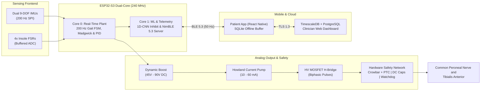

# StrideX: Closed-Loop Transcutaneous FES Orthosis for Foot Drop Rehabilitation

[](https://opensource.org/licenses/Apache-2.0)
[](https://www.espressif.com/en/products/socs/esp32-s3)
[](#)
[](https://ce.pdn.ac.lk/)

> **CO3060: Computer Systems Design Project (3YP)**  
> **Department of Computer Engineering, Faculty of Engineering, University of Peradeniya**  
> **Team 16 — StrideX:** E/22/182 | E/22/291 | E/22/449 | E/22/452  
> **Repository:** [cepdnaclk/e22-3yp-fes-foot-drop-orthosis](https://github.com/cepdnaclk/e22-3yp-fes-foot-drop-orthosis)

---

## Overview

Foot drop caused by upper motor neuron lesions from stroke, multiple sclerosis, or incomplete spinal cord injury impedes voluntary ankle dorsiflexion during the swing phase of walking. Passive Ankle-Foot Orthoses (AFOs) immobilize the joint, leading to muscle atrophy and compensatory gait movements.

**StrideX** is an active, wearable, closed-loop cyber-physical orthosis. Using multi-modal sensor fusion and on-device machine learning, it detects gait phase transitions in real time and delivers charge-balanced, constant-current biphasic electrical stimulation to the common peroneal nerve and tibialis anterior muscle during pre-swing and swing phases. Telemetry streams via BLE 5.3 to a mobile app and cloud platform for gait analysis and remote clinician prescription management.

---

## System Architecture



---

## Key Features

* **Multi-Modal Sensor Fusion:** Samples two 9-DOF IMUs (shank and foot) at 200 Hz via SPI and four analog insole Force-Sensitive Resistors (FSRs).
* **Deterministic Gait Phase FSM:** Detects 5 gait states; triggers stimulation within $\le 15\text{ ms}$ of toe-off and ramps down within $15\text{ ms}$ upon heel-strike.
* **Closed-Loop Dorsiflexion PID:** Computes real-time foot pitch relative to the shank at 200 Hz via a Madgwick filter and modulates pulse width ($150 - 450\,\mu\text{s}$) to maintain ground clearance.
* **Edge ML Inadvertent Stimulation Inhibit:** Onboard TensorFlow Lite 1D-CNN classifies non-locomotive movement (stairs, stationary standing) to prevent false triggering.
* **Regulated Constant-Current Driver:** Delivers $10 - 60\text{ mA}$ ($0.5\text{ mA}$ steps) biphasic square pulses ($25 - 40\text{ Hz}$) backed by a dynamic $45\text{V} - 90\text{V}$ compliance boost converter.
* **Multi-Tiered Fail-Safe Protection:**
  * Discrete thyristor crowbar clamps the high-voltage rail and blows a resettable PTC fuse in $<50\,\mu\text{s}$ if current exceeds $85\text{ mA}$ for $>1\text{ ms}$.
  * Series DC-blocking capacitors ($4.7\,\mu\text{F}, 100\text{V}$) eliminate DC leakage risk.
  * Dedicated external hardware watchdog IC (50 ms timeout).
  * $50\text{ kHz}$ sub-sensory check pulse detects electrode detachment before firing.
  * Physical master rocker switch for immediate mechanical battery disconnect.
* **Mobile & Cloud Telemetry:** 50 Hz binary telemetry over BLE 5.3, offline SQLite caching in a React Native companion app, and cloud analytics computing the Gait Symmetry Index (GSI) and muscle fatigue trends.

---

## System Specifications

| Parameter | Specification |
|:---|:---|
| **Microcontroller** | ESP32-S3 Dual-Core Xtensa LX7 @ 240 MHz |
| **Sensor Sampling** | Dual 9-DOF IMUs @ 200 Hz (SPI), 4x Insole FSRs (ADC) |
| **Gait Latency** | $\le 15\text{ ms}$ post toe-off trigger; $15\text{ ms}$ heel-strike ramp-down |
| **Current Output** | $10\text{ mA}$ to $60\text{ mA}$ constant current ($\pm 1\%$ across $500\,\Omega - 2.5\text{ k}\Omega$, $0.5\text{ mA}$ resolution) |
| **Pulse Width & Frequency** | $150\,\mu\text{s} - 450\,\mu\text{s}$ biphasic; $25\text{ Hz} - 40\text{ Hz}$ |
| **Compliance Voltage** | Dynamically adjusted $45\text{V}$ to $90\text{V DC}$ |
| **Hardware Safety** | Thyristor crowbar ($>85\text{ mA}$ trip, $<50\,\mu\text{s}$), $4.7\,\mu\text{F}$ DC-blocking caps, 50 ms watchdog IC |
| **Battery Life** | $\ge 12\text{ hours}$ continuous assistance ($3.7\text{V}, 2000\text{ mAh}$ Li-ion) |
| **Wireless & Cloud** | BLE 5.3 (50 Hz binary), TLS 1.3 / HTTPS / WSS, TimescaleDB & PostgreSQL |

---

## Repository Structure

```
├── firmware/         # ESP-IDF firmware (FreeRTOS, Madgwick, PID, FSM, TFLite Micro)
├── hardware/         # KiCad schematics, 4-layer PCB layouts, and 3D CAD models
├── mobile/           # React Native companion app with offline SQLite sync
├── cloud/            # Telemetry ingestion, TimescaleDB migrations, and Next.js portal
└── docs/             # System specifications, signal flow, and safety dossier
```

---

## Safety Disclaimer

> [!WARNING]
> **Research Prototype:** StrideX is an academic research device capable of delivering up to $90\text{V DC}$ and $60\text{ mA}$ electrical pulses. It is intended for experimental evaluation under qualified supervision and is contra-indicated for individuals with implanted electronic devices (pacemakers, ICDs).

---

## License

This project is licensed under the [Apache License 2.0](LICENSE).
